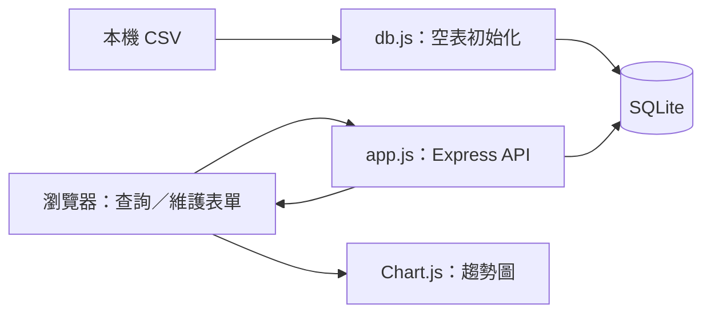

# 漁產價格查詢與維護｜WebFinalProject

## 系統簡介

將本機 CSV 漁產資料匯入 SQLite，以網頁查詢產品、民國年份區間與價格趨勢，並練習新增／更新價格的前後端串接。適合用來說明資料匯入、參數化 SQL 與圖表呈現；不是即時報價或價格預測服務。

| 項目 | 說明 |
| --- | --- |
| 前端 | HTML、CSS、JavaScript、Bootstrap、Chart.js |
| 後端 | Node.js、Express 4、cors |
| 資料 | SQLite、csv-parser、本機 CSV |
| 定位 | 課程型全端練習，限本機展示 |

## 使用情境與開發動機

價格資料以 CSV 保存時，直接閱讀檔案不易比較不同產品與年份。本系統以網頁整合產品選擇、區間查詢、表格與折線圖，並提供資料維護入口，讓使用者在同一介面查看歷年變化。

## 核心功能

| 功能 | 說明 |
| --- | --- |
| 產品與年份查詢 | 從資料庫提供產品及可查年份選項。 |
| 區間價格比較 | 指定產品與完整起訖民國年，呈現排序後的價格資料。 |
| 視覺化 | 以表格及 Chart.js 折線圖呈現歷年價格變化。 |
| 資料維護 | 透過表單新增或更新相同產品／年份的價格。 |
| 初始化 | 資料表為空時讀取隨附 CSV，已有資料則略過匯入。 |

## 系統架構



### 資料模型

主要資料表為 `fishery_wholesale_prices`，包含 `id`、`product_name`、`year`、`price_per_kg` 與 `unit`。HTTP 啟動由 `bin/www` 負責；資料庫連線、建表與初始匯入集中在 `db.js`。

## 技術實作重點

- 前端使用 Fetch 取得產品、年份與價格資料，再更新表格與圖表。
- 主要查詢使用參數綁定組合 SQL，不把產品輸入直接串進查詢字串。
- CSV 空表匯入與既有資料保留分開處理，重新啟動不會自動重設資料。
- 新增／更新價格的實作仍是先查後寫，不把它描述成具唯一性保證的交易式 upsert。

## 功能實作細節

- 從資料庫讀取產品清單與可查年份；依產品、起訖民國年查詢。
- 將價格結果呈現為表格與折線圖。
- 以表單新增價格；同產品與年份已有資料時更新。
- 資料庫為空時自動匯入 CSV；已有資料時略過匯入，避免每次啟動重複載入。

這裡的新增／更新是先查後寫，尚未提供交易式唯一性保障；沒有帳號、寫入權限或即時外部資料同步。

## 本機啟動

需要 Node.js、npm，以及可安裝鎖檔中 `sqlite3` 原生模組的環境。此專案未宣告 Node engines；本次未另行驗證 Node 版本相容矩陣。

```bash
git clone https://github.com/Ct2510/113-2_FCU_Web-Programming-Assignments.git
cd 113-2_FCU_Web-Programming-Assignments/assignments/WebFinalProject
npm ci
npm start
```

等待終端顯示 CSV 匯入完成，或已存在資料而略過匯入後，開啟 <http://127.0.0.1:3000/>。首次匯入為非同步，過早請求可能尚未就緒；可稍後重新整理。Bootstrap／Chart.js 由 CDN 載入，圖表需要網路。

連接埠被佔用時，PowerShell 可先執行 `$env:PORT = "3001"`，再 `npm start`；macOS／Linux 可用 `PORT=3001 npm start`。

**安全提醒：目前伺服器未明確只綁定 loopback，API 無登入且允許跨來源請求。請在受控本機環境使用，不要設定對外轉發或部署為公開服務。**

## 目錄導覽

| 路徑 | 用途 |
| --- | --- |
| [bin/www](bin/www) | HTTP 伺服器與連接埠 |
| [app.js](app.js) | 靜態網站與 API 路由 |
| [db.js](db.js) | 建表、CSV 匯入及資料庫連線 |
| [public/index.html](public/index.html) | 查詢／維護頁面 |
| [public/javascripts/script.js](public/javascripts/script.js) | Fetch、表單與 Chart.js |
| [public/stylesheets/](public/stylesheets/) | 網站樣式 |
| [來源 CSV](3f22734f46b814a22e7585dc6b1cea99_export.csv) | 隨附資料快照 |

執行後產生 `db/sqlite.db`，已由既有 [.gitignore](.gitignore) 排除。請自行備份本機資料；不要為了重匯而直接刪除有需要的資料庫。

## API 文件

| 方法 | 路徑 | 用途 |
| --- | --- | --- |
| GET | `/api/products` | 產品清單 |
| GET | `/api/years/:product` | 產品的民國年份 |
| GET | `/api/prices/:product?startYear=102&endYear=112` | 指定產品的區間價格 |
| POST | `/api/fish-prices` | 新增或更新產品年份價格 |

產品名稱須作 URL 編碼；年份須以資料庫實際存在者為準。寫入端點接受 JSON 的 `product_name`、`year`、`price_per_kg`、`unit`；成功回覆 `message` 與 `id`，更新時另含 `changes`。缺值／無法轉為數字回覆 400；資料庫失敗回覆 500。現有驗證使用 truthy 與 parseInt／parseFloat，對數值 0、部分混合字串等情況仍有限制。

## 驗證與限制

本次整理依原始碼核對文件，**沒有重新安裝、啟動或執行功能測試**。專案未提供自動測試指令。可依以下流程手動驗證，但本次尚未執行：

1. 在隔離的專案副本安裝、啟動，等待匯入完成。
2. 選擇資料中存在的產品與起訖年份，確認表格排序與圖表。
3. 在示範資料庫新增／更新價格，重新啟動後確認保存。
4. 檢查空結果、錯誤輸入與 CDN 失敗時的畫面；不要把清單視為通過紀錄。

- 舊 `GET/POST /api/prices` 使用未由目前初始化流程建立的 `prices` 表，可能回傳 500，不應與主要產品查詢 API 混用。
- 除錯端點與寫入 API 沒有權限保護；欄位驗證、錯誤處理、XSS 防護及資料遷移仍待加強。
- 隨附 CSV 的資料發布來源、授權及更新日期未完整記載；不宣稱資料即時、官方認證或可任意再散布。
- 本次未變更程式、依賴或資料內容。
